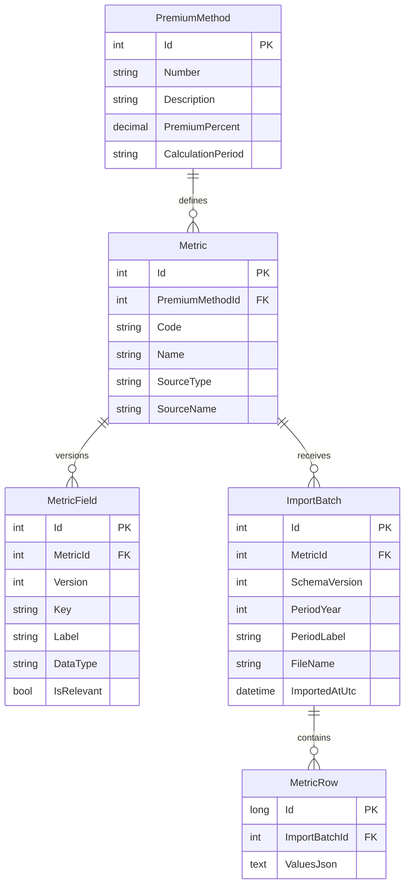

# Signal Ledger

A focused Full Stack solution for managing premium methods, metric definitions, and heterogeneous Excel inputs.

## Assignment Coverage

The Hebrew brief asks for an Angular client, .NET Core Web API, and SQLite relational database. The primary demonstrated flow is screen 3: select a metric, inspect dynamically defined fields, search imported rows, upload an Excel file, and review import history.

Implemented:

- Premium method API with number, description, premium percentage, and calculation period.
- Metric metadata API, including source and relevant fields.
- Excel import endpoint with period, schema version, row count, status, and file name.
- Dynamic field-driven data table with server-side paging and search.
- Import history endpoint and audit display.
- SQLite/EF Core relational metadata with JSON row payloads.
- Seeded employee metric and sample Q1 2026 batch for deterministic demonstration.

## Run

Prerequisites: .NET SDK 9 and Node.js 20+.

```powershell
dotnet run --project backend --urls http://localhost:5006
npm start --prefix frontend
```

Open `http://localhost:4200`. The frontend expects the API at `http://localhost:5006`.

Build and tests:

```powershell
dotnet build backend/backend.csproj
npm run build --prefix frontend
npm test --prefix frontend -- --watch=false --browsers=ChromeHeadless
```

## Architecture

### Backend Layers

The backend is intentionally split into four responsibilities:

- `Controllers`: HTTP routing, request binding, and HTTP status responses only.
- `MetricsBL`: application rules, pagination limits, relevant-field selection, schema-version selection, and import orchestration.
- `MetricsBL/Interfaces`: business service contracts used by controllers and tests.
- `MetricsDAL`: EF Core queries and persistence operations behind focused repository interfaces.
- `MetricsDAL/Interfaces`: repository and import-reader contracts.
- `MetricsDAL/Import`: Excel parsing behind `IExcelImportReader`; it returns neutral headers and rows without applying business rules.

The main import flow is `MetricsController -> MetricService -> IExcelImportReader + IMetricRepository -> AppDbContext -> SQLite`. Dependency injection wires these interfaces in `Program.cs`, which keeps the business layer testable without HTTP or Excel implementation details.



`MetricField` is relational because it controls validation, display, relevance, and schema history. `MetricRow.ValuesJson` stores each row's variable columns without requiring a migration for every new metric or Excel column. A batch records the exact schema version used, so older records remain readable after a file changes.

The production extension point is a mapping table (`MetricFieldAlias` or `ImportColumnMapping`) that maps arbitrary Excel headers to stable field keys. The current timed implementation demonstrates the stable-key path: headers matching relevant field keys are imported, and irrelevant columns are ignored.

## Key SQL

The EF model creates these important indexes:

```sql
CREATE UNIQUE INDEX IX_Metric_Code ON Metrics(Code);
CREATE UNIQUE INDEX IX_MetricField_Metric_Version_Key ON MetricFields(MetricId, Version, Key);
CREATE INDEX IX_ImportBatch_Metric_Period ON ImportBatches(MetricId, PeriodYear, PeriodLabel);
CREATE INDEX IX_MetricRow_Batch ON MetricRows(ImportBatchId);
```

Paged query concept:

```sql
SELECT Id, ImportBatchId, ValuesJson
FROM MetricRows
WHERE ImportBatchId IN (SELECT Id FROM ImportBatches WHERE MetricId = @metricId)
  AND ValuesJson LIKE '%' || @search || '%'
ORDER BY Id DESC
LIMIT @pageSize OFFSET (@page - 1) * @pageSize;
```

## Alternatives and Decision

1. **JSON rows plus relational field metadata (chosen).** Flexible, low migration cost, good write performance, and straightforward dynamic rendering. It is less efficient for typed cross-row filtering and requires JSON indexes or a search projection at scale.
2. **Entity-Attribute-Value tables.** Very flexible and searchable by individual values, but produces many rows, complicated typed queries, and higher maintenance/query complexity.
3. **One physical table per metric or Excel shape.** Strong SQL typing and fast reporting for known metrics, but schema migrations and deployment coordination are required for every change. It becomes difficult to manage as metrics grow.

The chosen hybrid fits the brief's frequent shape changes and limited fixed business metadata. For large production volumes, I would add a typed search projection or a separate analytics store while retaining immutable raw rows.

## Changed Excel Scenario

When Employees adds `manager` and `location`, the importer detects the new header set and stores a new `SchemaVersion`. No database migration is needed. In the current demo, a field definition/configuration update is needed to mark those stable keys as relevant; importer code does not change. Historical Q1 rows retain schema version 1 and their original JSON. New rows use the new version, with missing old fields represented as absent/null when displayed.

## Assumptions and Limitations

- Authentication, authorization, background jobs, virus scanning, and durable file storage are outside the 3-hour scope.
- The API accepts Excel `.xlsx`/`.xls` files and reads the first worksheet.
- The demo uses stable field keys as headers. A production alias/mapping UI is the next increment.
- The UI focuses on the required screen 3; premium method and metric management are represented by APIs and seeded metadata.
- Search is intentionally simple JSON text search. Typed field filters and JSON indexes are recommended for production.

## AI Disclosure

GitHub Copilot was used for decomposition, scaffolding assistance, implementation suggestions, and validation guidance. The architecture, tradeoffs, code review, and final decisions remain the candidate's responsibility.
