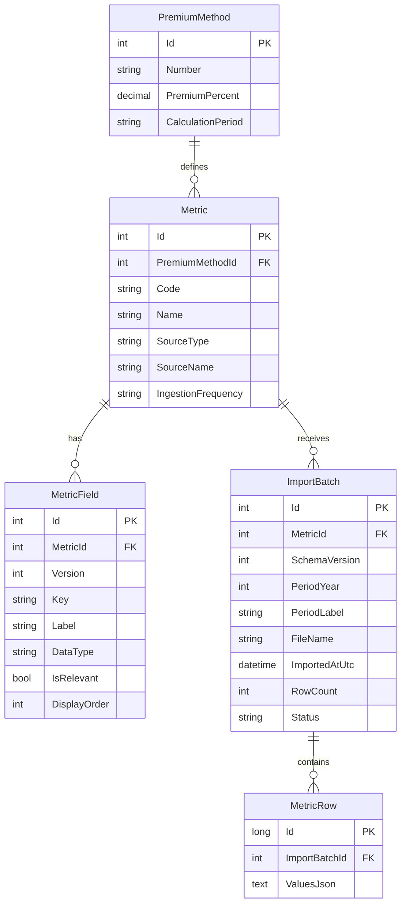

# Full Stack Professional Assignment Submission

**Candidate solution:** Signal Ledger

**Repository:** https://github.com/sara-zeywalld/Home-work

**Technologies:** Angular, ASP.NET Core Web API (.NET 9), EF Core, SQLite, ExcelDataReader, CSV parser

## 1. Short Specification

The system manages premium methods, their metrics, and imported data files whose structures can differ between metrics and change over time.

The main demonstrated flow is screen 3: select a metric, create a new metric when needed, upload a CSV or Excel file for a year and period, view import history, and inspect rows in a dynamically generated table.

The solution also exposes API support for premium methods and metric creation. For example, a Stores metric can be created under an existing premium method and then receive a Stores file with columns such as `storeCode`, `region`, `salesAmount`, and `transactionCount`.

## 2. ERD and Architecture



Request flow:

```text
Angular -> MetricsController -> MetricService -> IExcelImportReader
                                      |                  |
                                      v                  v
                                IMetricRepository   CSV/Excel parser
                                      |
                                      v
                               EF Core -> SQLite
```

The backend is separated into Controllers, MetricsBL, MetricsDAL, and import infrastructure. Interfaces are kept in the inner `Interfaces` folders.

## 3. Database Design

The database is SQLite with a relational structure compatible with a future SQL Server implementation.

- `PremiumMethod` stores method number, description, premium percentage, and calculation period.
- `Metric` belongs to one premium method and stores metric/source metadata.
- `MetricField` stores field definitions, data type, relevance, display order, and version metadata.
- `ImportBatch` stores the uploaded file, business year/period, status, row count, timestamp, and schema version.
- `MetricRow` stores one imported row and links it to its import batch.
- `ValuesJson` stores variable columns as JSON. It is the only intentionally dynamic part of the row model.

Important indexes:

```sql
CREATE UNIQUE INDEX IX_Metrics_Code ON Metrics(Code);
CREATE UNIQUE INDEX IX_MetricFields_MetricId_Version_Key
    ON MetricFields(MetricId, Version, Key);
CREATE INDEX IX_ImportBatches_MetricId_Period
    ON ImportBatches(MetricId, PeriodYear, PeriodLabel);
CREATE INDEX IX_MetricRows_ImportBatchId
    ON MetricRows(ImportBatchId);
```

The implementation uses EF Core conventions for foreign keys and `EnsureCreated` for the timed demo. EF Core migrations would be preferred for production deployment.

## 4. SQL Queries and Procedures

The application does not use stored procedures or hand-written SQL commands. It uses EF Core LINQ, which generates parameterized SQLite SQL. The statements below are representative SQL for every database operation implemented by the repositories and startup seed logic. EF Core may change aliases, parameter names, or combine statements when it executes them.

### Read operations

Get all premium methods and their metrics (`GET /api/premium-methods`):

```sql
SELECT p.*, m.*
FROM PremiumMethods AS p
LEFT JOIN Metrics AS m ON m.PremiumMethodId = p.Id;
```

Get all metrics and their fields (`GET /api/metrics`):

```sql
SELECT m.*, f.*
FROM Metrics AS m
LEFT JOIN MetricFields AS f ON f.MetricId = m.Id;
```

Get one metric with its fields, used before reading rows or importing a file:

```sql
SELECT m.*, f.*
FROM Metrics AS m
LEFT JOIN MetricFields AS f ON f.MetricId = m.Id
WHERE m.Id = @metricId;
```

Get import history (`GET /api/metrics/{id}/imports`):

```sql
SELECT Id, MetricId, SchemaVersion, PeriodYear, PeriodLabel,
     FileName, ImportedAtUtc, RowCount, Status
FROM ImportBatches
WHERE MetricId = @metricId
ORDER BY ImportedAtUtc DESC;
```

Find rows that belong to a metric. The LINQ `Any` expression becomes an `EXISTS` subquery:

```sql
SELECT r.Id, r.ImportBatchId, r.ValuesJson
FROM MetricRows AS r
WHERE EXISTS (
  SELECT 1
  FROM ImportBatches AS b
  WHERE b.Id = r.ImportBatchId
    AND b.MetricId = @metricId
);
```

Count matching rows for pagination:

```sql
SELECT COUNT(*)
FROM MetricRows AS r
WHERE EXISTS (
  SELECT 1
  FROM ImportBatches AS b
  WHERE b.Id = r.ImportBatchId
    AND b.MetricId = @metricId
)
  AND r.ValuesJson LIKE '%' || @search || '%';
```

The `LIKE` condition is added only when the user supplies a non-empty search value. Fetch one page of rows:

```sql
SELECT r.Id, r.ImportBatchId, r.ValuesJson
FROM MetricRows AS r
WHERE EXISTS (
  SELECT 1
  FROM ImportBatches AS b
  WHERE b.Id = r.ImportBatchId
    AND b.MetricId = @metricId
)
  AND r.ValuesJson LIKE '%' || @search || '%'
ORDER BY r.Id DESC
LIMIT @pageSize OFFSET @offset;
```

`@offset` is calculated as `(@page - 1) * @pageSize`.

### Write operations

Create a premium method (`POST /api/premium-methods`):

```sql
INSERT INTO PremiumMethods
  (Number, Description, PremiumPercent, CalculationPeriod)
VALUES
  (@number, @description, @premiumPercent, @calculationPeriod);
```

Create a metric (`POST /api/metrics`):

```sql
INSERT INTO Metrics
  (PremiumMethodId, Code, Name, Description, SourceType,
   SourceName, IngestionFrequency)
VALUES
  (@premiumMethodId, @code, @name, @description, @sourceType,
   @sourceName, @ingestionFrequency);
```

When an imported file contains a new field, EF Core inserts it into `MetricFields`:

```sql
INSERT INTO MetricFields
  (MetricId, Version, Key, Label, DataType, IsRelevant, DisplayOrder)
VALUES
  (@metricId, @version, @key, @label, @dataType, @isRelevant, @displayOrder);
```

When an existing inactive field appears again, the import activates it:

```sql
UPDATE MetricFields
SET IsRelevant = 1
WHERE Id = @fieldId;
```

Create an import batch (`POST /api/metrics/{id}/import`):

```sql
INSERT INTO ImportBatches
  (MetricId, SchemaVersion, PeriodYear, PeriodLabel, FileName,
   ImportedAtUtc, RowCount, Status)
VALUES
  (@metricId, @schemaVersion, @periodYear, @periodLabel, @fileName,
   @importedAtUtc, @rowCount, @status);
```

Insert each imported row as JSON:

```sql
INSERT INTO MetricRows
  (ImportBatchId, ValuesJson)
VALUES
  (@importBatchId, @valuesJson);
```

### Startup database operations

At startup, `EnsureCreated` creates the SQLite schema if it does not exist. The seed logic then checks whether data already exists:

```sql
SELECT EXISTS (
  SELECT 1
  FROM PremiumMethods
);
```

If the database is empty, it executes the same `INSERT` operations shown above for the sample premium method, metric, fields, import batch, and three sample rows. Each `SaveChangesAsync` call is translated into one or more parameterized `INSERT` or `UPDATE` statements, usually inside an EF Core transaction.

The API validates the metric and requested page size before querying. In a production version, dynamic filters and sorting would whitelist field keys and use SQLite JSON functions or typed projections rather than arbitrary SQL fragments.

## 5. Dynamic Data Solution

The chosen design is a hybrid relational/JSON model:

- Stable business metadata remains relational.
- Each imported row is stored as a JSON object in `MetricRow.ValuesJson`.
- `MetricField` describes which keys are displayed, their labels, data types, relevance, and order.
- The Angular table receives fields and rows from the API and renders columns dynamically.
- New metrics and new columns do not require a new physical SQL column or migration.
- Import batches retain the file name, period, row count, timestamp, and schema version.

When an uploaded file contains a new header, the importer creates a `MetricField`. When a known inactive field appears in a file, it is reactivated. This supports the changed Employees scenario and unrelated metrics such as Stores.

For the example file:

```text
id,name,age,manager
```

the system creates or activates those fields and stores rows such as:

```json
{"id":"123","name":"John","age":"23","manager":"Smith"}
```

A production enhancement would add immutable schema snapshot tables and an explicit source-column mapping screen. This would allow users to decide which columns are relevant and preserve complete source data independently from the current display configuration.

## 6. Alternatives and Decision

### Alternative A: Dedicated relational table per metric

**Advantages:** strong types, constraints, indexes, reporting, and excellent SQL filtering.

**Disadvantages:** every new metric or file structure requires schema and code changes; historical layouts are harder to maintain.

**Complexity:** medium initially and high over time. Best performance for known reports, lowest flexibility for future changes.

### Alternative B: EAV tables

Store one row for each entity, field, and value.

**Advantages:** flexible fields and SQL-searchable values.

**Disadvantages:** many rows, complex typed queries, difficult joins, and more complicated maintenance.

**Complexity:** medium to high. Flexible, but query and validation logic become difficult.

### Alternative C: Relational metadata plus JSON rows, chosen

**Advantages:** no migration for every file change, simple ingestion, dynamic rendering, import history, and relational control over metadata.

**Disadvantages:** typed filtering and sorting over JSON are weaker than normal columns; large analytical workloads may need projections.

**Complexity:** low to medium for the assignment and medium for production hardening.

The chosen solution best balances flexibility, implementation time, relational integrity, and the requirement to support heterogeneous Excel files. It is not Elasticsearch: SQLite remains the primary database, and JSON is used only for variable row payloads.

## 7. Screen Sketches

### Screen 1: Premium methods

```text
Premium Methods                         [+ New method]

Method number | Description | Premium % | Calculation period | Actions
PM-2026-01    | Annual ...  | 7.5        | Quarterly           | Edit
```

### Screen 2: Metrics

```text
Metrics
------------------------------------------------------------
Active metric: [ Employees v ]             [+ New metric]

Available metrics
Code       | Name       | Source | Frequency
employees  | Employees  | Excel  | Quarterly
stores     | Stores     | Excel  | Monthly

When [+ New metric] is selected:
Code [ stores ]   Name [ Stores ]   Source [ Excel v ]
Description [ Store sales and transaction data          ]
Frequency [ Monthly v ]                         [Create metric]
```

### Screen 3: Import and view data

```text
Active metric [Stores v]  Search [........]  [+ Import file]

Imported records                         2026 / Q2
Store code | Region | Sales amount | Transactions | Batch
S-001      | North  | 12000        | 80           | #12

Relevant fields                          Import history
storeCode                                 stores-q2.csv / 3 rows
region
salesAmount
transactionCount
```

The current Angular implementation provides the dynamic data workspace, new metric form, upload control, search, pagination, active fields, and import history.

## 8. API Design

Implemented endpoints:

- `GET /api/premium-methods`
- `POST /api/premium-methods`
- `GET /api/metrics`
- `POST /api/metrics`
- `GET /api/metrics/{id}/rows?page=1&pageSize=25&search=value`
- `GET /api/metrics/{id}/imports`
- `POST /api/metrics/{id}/import`

Create metric request:

```json
{
  "premiumMethodId": 1,
  "code": "stores",
  "name": "Stores",
  "description": "Store sales and transaction data",
  "sourceType": "Excel",
  "sourceName": "Store reporting export",
  "ingestionFrequency": "Monthly"
}
```

Import request uses `multipart/form-data`:

```text
file: stores-q2.csv or stores-q2.xlsx
year: 2026
period: Q2
```

The import response contains the batch ID, file name, row count, and schema version. The rows response returns fields and data together so Angular can build the table dynamically.

## 9. Additional Questions and Professional Considerations

### How does a changed Employees file work?

The existing Employees metric can receive a file with additional headers such as `manager` and `location`.

- **Detection:** the importer reads the header row and compares each header with the metric's `MetricField` definitions. Missing headers are created automatically.
- **Database:** no migration is required. The new fields are rows in `MetricField`, while row values remain in `MetricRow.ValuesJson`.
- **Code:** no change is required for additive columns. Validation, typed parsing, required fields, or renamed-column mapping would require additional code.
- **Configuration:** no manual configuration is required in the current implementation. A future field-mapping screen could control labels, types, relevance, and aliases.
- **History:** `ImportBatch.SchemaVersion` and `MetricField.Version` record the schema version information. A production system should add immutable schema snapshots for a complete historical definition.
- **Compatibility:** old JSON rows remain unchanged. Their missing new values are displayed as empty or `—`; new rows contain the additional properties.

### How are large data volumes handled?

The API applies server-side pagination and a maximum page size. The browser does not load all rows at once. For production scale, JSON search can be optimized with SQLite JSON indexes, generated columns, or a typed search projection while preserving the relational import model.

### How are data types handled?

Field metadata includes `DataType`. The timed implementation stores parsed values as JSON-compatible text values. Production hardening would validate and normalize dates, numbers, decimals, and booleans during import and return row-level validation errors.

### Why not Elasticsearch?

The assignment requires SQLite for the test. Elasticsearch could be added later as a read/search projection for very large volumes, but it is not necessary and must not replace the required relational SQLite database.

## Delivery Notes

- Source code: https://github.com/sara-zeywalld/Home-work
- AI tool used: GitHub Copilot
- AI conversation/history summary: `AI_USAGE.md`
- Main run commands are documented in `README.md`.
- The evaluator can demonstrate a Stores import by creating a Stores metric, selecting it, and uploading a Stores CSV or Excel file.
