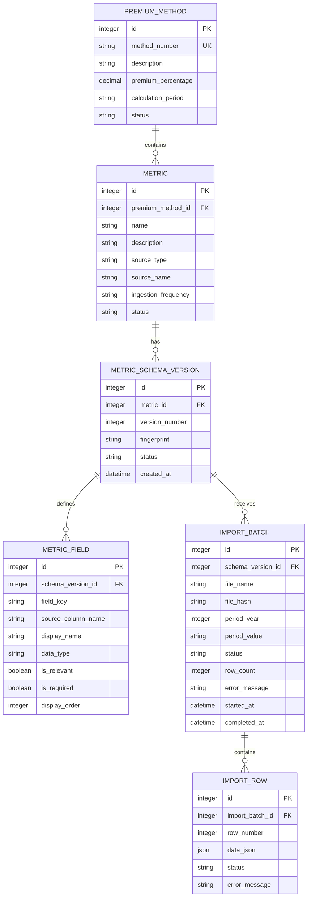

# Database Design: Premium Methods and Dynamic Metric Imports

## Recommended Approach

Use a relational metadata plus JSON data model:

- Keep business entities, field definitions, schema versions, and import history in relational tables.
- Store each imported Excel row as a JSON object in `import_row.data_json`.
- Return the configured fields and JSON rows together so Angular can build the table dynamically.
- Never update an old schema version in place. Create a new version when an Excel structure changes.

This gives the application flexibility for new metrics and changing Excel columns without requiring a database migration for every file layout, while keeping the important system metadata relational.

## ERD

## Tables and Responsibilities

### `premium_method`

Stores the premium method itself: method number, description, percentage, calculation period, and lifecycle status.

### `metric`

Stores a metric belonging to one premium method. `premium_method_id` is a foreign key to `premium_method.id`. One premium method can contain many metrics, while each metric belongs to one premium method. `source_type` can initially be `Excel`; the model leaves room for a future external interface without changing the metric table.

### `metric_schema_version` and `metric_field`

Describe the expected structure of a metric's Excel file. A schema version contains the fields detected or configured for one layout. `field_key` is a stable internal name; `source_column_name` is the column header in the Excel file. These must not be treated as the same thing because a source header can be renamed.

### `import_batch`

Represents one uploaded file for one metric and one business period. The metric is determined through `schema_version_id -> metric_schema_version.metric_id`, so a duplicate `metric_id` is not needed here. The table stores file identity, the schema version used, processing status, counts, and errors. This is the import history required by the assignment.

### `import_row`

Stores one row from an import. `data_json` contains the complete row as a generic object, including columns that are not currently relevant. `status` and `error_message` preserve row-level validation results. This preserves the original input and supports dynamic display.

## Import Batch Fields

- `schema_version_id`: identifies the metric and the exact Excel structure used by this upload.
- `file_name`: shows the original file in import history and helps users identify an upload.
- `file_hash`: a SHA-256 fingerprint used to detect the same file being uploaded twice for the same period. It is not a security password.
- `period_year` and `period_value`: identify the business period represented by the file, such as `2026` and `Q1`.
- `status`: shows whether processing is `Processing`, `Completed`, `CompletedWithErrors`, or `Failed`.
- `row_count`: supports import summaries and pagination without counting rows on every screen load.
- `error_message`: stores a batch-level failure message, such as an unreadable file. Row-specific errors belong on `import_row`.
- `started_at` and `completed_at`: record when processing began and ended, provide audit history, and make duration and stuck imports visible.

`file_hash`, `error_message`, and the timestamps are not needed to display a successful row, but they are valuable for reliable import history and troubleshooting. For a very small demo, `file_hash` can be omitted, but keeping it demonstrates idempotent import handling.

## Important Constraints and Indexes

- `premium_method.method_number` is unique.
- `(metric_id, version_number)` is unique.
- `(schema_version_id, file_hash, period_year, period_value)` should be unique when duplicate uploads must be prevented.
- `metric.name` is unique.
- `(schema_version_id, field_key)` is unique.
- `(schema_version_id, source_column_name)` is unique.
- `(import_batch_id, row_number)` is unique.
- Index every foreign key used in joins.
- Index `import_batch(schema_version_id, period_year, period_value, status)` for history and period filtering.
- Index `import_row(import_batch_id, row_number)` for paginated retrieval.

## Why This Is Better Than Only `imports_data(value)`

The proposed JSON row is a good foundation, while a single untyped `value` column would make the data difficult to interpret. The design keeps JSON flexibility while adding:

- field data types and relevance configuration;
- schema version history;
- import-level traceability;
- compatibility with old rows after a file layout changes.

For the test, filtering and sorting are implemented through a whitelist of configured fields and SQLite JSON functions. A typed projection table can be added later if query volume requires it, but it is not needed for the first version.

SQLite can store JSON as `TEXT`; in SQL Server the same logical design can use `nvarchar(max)` with JSON functions, or a JSON column where supported.
